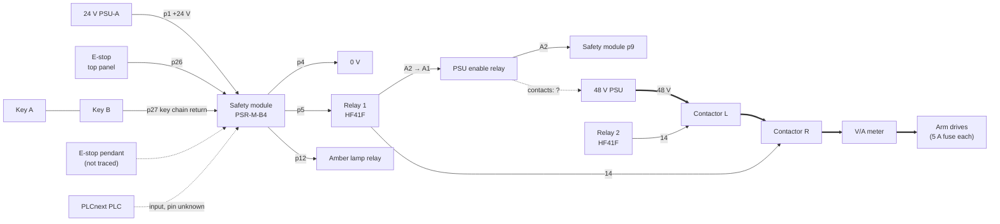

# AgroBot Electrical System

Reverse-engineering notes for the AgroBot's electrical system: the tomato-picking arm, its power tower, safety chain and CAN motor network.

> **Status:** the robot is not currently working. This document combines a recorded walkthrough by last year's electrical lead with this year's field notes from tracing the hardware. Anything marked **unconfirmed** or **?** has not been checked on the robot yet. Verify before you power up.

*Block-level schematic. Colors: brown = 110 VAC, red = 48 V motive, blue = 24 V logic, purple = CAN, green = Ethernet/USB, dotted green = Wi-Fi, amber dashed = safety signal, gray dashed = present but unused.*

## Contents

- [At a glance](#at-a-glance)
- [Power architecture](#power-architecture)
- [Safety stack](#safety-stack)
- [Parts identified](#parts-identified)
- [Control and communications](#control-and-communications)
- [Joints and drives](#joints-and-drives)
- [Wire colors](#wire-colors)
- [Current state](#current-state)
- [Suggested scope of work](#suggested-scope-of-work)
- [Working safely](#working-safely)
- [Open questions](#open-questions)

## At a glance

The AgroBot is electrically simple but physically large: one pattern repeated seven times and woven through the arm. Almost every cable carries the same conductors:

| Rail | Purpose |
|---|---|
| **48 V** | Motive power. The only thing that can make the arm move. |
| **24 V** | Logic power. Keeps drives powered and communicating, so the robot remembers its position after an E-stop. |
| **CAN H / L** | CANopen communication to every drive (daisy chain). |
| **GND** | Common ground. Logic and power grounds are run separately but sit at the same potential. |

Every first-level safety system is built around cutting the 48 V rail. The gripper runs on 24 V, so it can still pinch after an E-stop.

## Power architecture

From the wall inward:

1. **Wall (110 VAC) → power strip.** Switched per outlet. Feeds the laptop, router/switch and the NUC extension. These are **not** behind the robot isolator.
2. **Robot power isolator.** Lockout-tagout switch with 3 lock points. Feeds the 110 VAC bus in the lower tray (G, L, N splitter blocks).
3. **Three supplies off the bus:**
   - **24 V PSU-A:** safety module only (p1).
   - **24 V PSU-B:** PLC and the robot's 24 V logic rail.
   - **48 V PSU:** Mean Well RSP-2000-48, motive power.
4. **48 V path:** PSU → two normally-open contactors in series → V/A meter → trunk through the arm. Each drive tees off through its own **5 A automotive fuse**, with a four-way connector per cluster of three drives.
5. **Wire gauge:** 48 V runs on 16 AWG two-conductor flat cable (red +, black −). The previous lead's calculations showed even 18 AWG was enough, because robot loads are spiky and wires run in open air.

**Supply rating (resolved):** 17.1 A on the label is the AC input current, not the output. On 110 VAC the RSP-2000-48 is limited to 31.5 A, and 31.5 A × 48 V ≈ 1510 W, which matches the walkthrough's "about 1500 W". The arm never came close to that in practice.

**Brake (regen) resistor:** two 1.8 Ω resistors in series (3.6 Ω) on an aluminum heatsink. Across 48 V that dumps about 13 A (~640 W). **Never wired.** The team relied on a drive's built-in braking circuit, which burned out. If the arm will move fast this year, decide where regenerated energy goes.

## Safety stack

- **Safety module** (Phoenix Contact PSR-M-B4): clock outputs send test pulses through the safe inputs to catch shorts and cross-wiring. Only when the inputs are healthy do the outputs energize the relay chain.
- **Two keys in series:** two people must be present before 48 V can come on. Last year's rule: both leads in the room.
- **Two contactors in series:** if a current spike welds one shut, the other still opens. At 48 V DC the arc is also split across two sets of contacts.
- **E-stops cut 48 V only.** 24 V stays live. The pendant E-stop lets the operator stand back.
- **Red tower lamp** is hardwired to E-stop status (per the walkthrough) and works with the PLC off.

### Traced safety module pins

| Pin | Connection |
|---|---|
| p1 | +24 V from the safety PSU (PSU-A) |
| p4 | 0 V |
| p5 | Relay 1 A1 |
| p9 | PSU enable relay A2 |
| p12 | Amber tower-lamp relay (assumed A1) |
| p26 | Top-panel E-stop |
| p27 | Key chain return (both keys in series) |
| ? | PLC input (reported, pin unknown) |
| ? | Pendant E-stop (not traced) |

> [!WARNING]
> **The enable relay drive is unresolved.** Traced: p5 → relay 1 A1, relay 1 A2 → enable relay A1, enable relay A2 → p9. That puts two relay coils **in series** between p5 and p9, possibly a two-pole (+24 V / 0 V) safe output. But two 24 V HF41F coils in series each see about 12 V, below the 18 V pick-up. An earlier note also tied relay 1 A2 to relay 2 A2 and ground, which would ground the enable relay's A1. These can't all be true. **Check:** the enable relay's model and coil voltage, the relay 1 A2 to ground resistance (power off), and what p5 and p9 are in the PSR-M-B4 datasheet's terminal table.

> [!WARNING]
> **Contactor coil voltage conflict.** The walkthrough said the contactor coils are 48 V. Field notes say 24 V (unconfirmed). The HF41F relays that switch them are rated **30 V DC max**, so 48 V coils would be over their rating. 24 V is more likely. Confirm on the coil label or by measuring.

> [!IMPORTANT]
> **No automatic restart.** Per the PSR-M-B4 datasheet, the machine must not restart by itself after an E-stop is released. Confirm that the module is configured with a manual reset input and a real reset button. The PLC is not a safety device, so its input should only be able to add a stop condition, never bypass one.

## Parts identified

### 48 V power supply: Mean Well RSP-2000-48

| | |
|---|---|
| Output | 48 V DC. 42 A / 2016 W rated; **31.5 A on 110 VAC** (label) |
| Input | 90 to 264 VAC (datasheet); 17.1 A max input current |
| Extras | Remote on/off, remote sense, 12 V and 5 V aux outputs, OVP / OTP / overload protection |

A power supply can't absorb energy the arm regenerates, so a hard deceleration pushes the rail up and can trip its overvoltage protection. That's another reason to finish the brake-resistor circuit. The label's "±48 V" likely refers to adjustment range; this supply has one 48 V output.

### Safety module: Phoenix Contact PSR-M-B4-SDI16-SDO4-DO4

| | |
|---|---|
| I/O | 16 safe inputs (pair two for a dual-channel device), 4 safe outputs, 4 clock outputs, 4 signal outputs, 4 reset inputs |
| Supply | 24 V DC nominal. **Never exceed 28.8 V DC** |
| Rating | Up to Cat. 4 / PL e, SIL 3 |
| Config | PSRmodular Software Lite |

### Interface relays: Hongfa HF41F + 41F socket (C2)

| | |
|---|---|
| Coil | 24 V DC, ~170 mW, 3390 Ω. Pick-up ≤ 18 V, drop-out ≥ 1.2 V. Operate 8 ms, release 4 ms |
| Contacts | 1 Form C (SPDT). **6 A, 30 V DC max** |
| Socket | 35 mm DIN rail, screw terminals, LED indicator and coil protection. 12 to 24 V AC/DC |
| Terminals | A1 (+) coil positive (input signal), A2 (−) coil negative (0 V), 11 COM, 12 NC, 14 NO |

Known wiring:

- **Relay 1:** A1 ← safety p5. 14 → right contactor. A2 → PSU enable relay A1.
- **Relay 2:** 14 → left contactor. A2 → ground (reported tied to relay 1 A2). A1 source unclear.

The socket protects only the relay's own coil. A contactor coil is a large inductor and needs its own flyback diode or suppressor, or the relay contacts will arc every time 48 V drops out.

### Light tower relays

| | |
|---|---|
| Lamps | 5 colors, 24 V. Each lamp turns on when its signal wire is pulled to ground |
| Lamp relays | One per color, cap color matches the lamp. Pin 14 (NO) → ground on all five |
| Amber relay | Coil driven by safety module p12 |
| Purple relay | Purple wire on pin 12 (NC). Pin 14 not grounded |
| Brown wire | On pin 12 (NC) of another relay. Pin 14 not grounded |

The purple and brown circuits work the opposite way from the lamps: they're connected while the relay is off and open when it turns on. Purple and brown are common light-tower wire colors for the buzzer and the shared supply, so check the tower's wire-color chart and where pin 11 (COM) on those relays goes. The red lamp's relay is likely also driven by a safety-module signal output.

### 48 V contactors (×2): labeled P20260120, Albright SW80-type

| | |
|---|---|
| Label | 60 V max, ~100 A. Coil 24 V (unconfirmed) |
| Genuine SW80 | 100 A continuous switched (125 A carried only). Breaks up to **48 V without blowout magnets**, 60 V carried only, 96 V with blowouts. Coils 6 to 240 V. Normally-open, single-pole |
| Wiring | In series on the 48 V output. Right coil ← relay 1 pin 14. Left coil ← relay 2 pin 14 |
| Origin | Probably not a genuine Albright part (possibly an Amazon or eBay clone). Don't trust the printed ratings |

Current isn't the concern (the supply tops out at 31.5 A). Breaking voltage is: a genuine SW80 without blowouts is rated to break exactly 48 V, and regen can push the rail higher. Two in series helps. For a clone, treat that margin as thin.

## Control and communications

### Motion: CANopen

- The NUC talks to the drives through a USB-to-CAN adapter (any **CANable**-compatible board). The old ones kept getting lost; buy a spare.
- Single **daisy chain**: every drive has CAN in and CAN out. No rings, stars or stubs. Connector pins: H, L, GND, shield (shield usually left unconnected). High and low must be on the same twisted pair.
- **PDO** frames at ~1 kHz carry position and velocity targets for every drive. Each drive picks out its own part, interpolates internally at much higher rates, and reports its filtered position back. Encoder data never leaves the drive.
- **SDO** handles configuration, homing setup and probably PID gains. Tuning was done with Maxon's auto-tune over USB.
- Every CANopen node expects all its peers to be present, so adding or removing a device (such as a swappable gripper) stops all motion. That's by design.

### Gripper

ESP32 on Wi-Fi, powered from 24 V, with a few hundred ms of latency. A 24 V + CAN run exists to the gripper, but it never joined the bus. The previous lead recommends keeping the gripper on a regular network unless it needs real-time control, and not reusing the current gripper hardware.

### PLC and operator panel

- **Phoenix Contact PLCnext** (Linux inside). 10 ms input scan. Exposes button states and lamp controls over **OPC UA**. Opening its program needs PLCnext Engineer (Windows).
- **Buttons:** Cycle, Auto, Halt, Step, Previous, plus an unwired mode-selector encoder.
- **Lamps:** 48 V on, 24 V on, E-stop, Fault, Moving. Fault and Moving were never driven; no software ever used the buttons.
- The panel is laser-cut and meant to be redesigned. Standard 22 mm holes.

## Joints and drives

| Joint | Motion | Drive / motor | Homing | Notes |
|---|---|---|---|---|
| J0 | Linear stage | Maxon BLDC + drive | Incremental | Added late; ignore until the arm works |
| J1 | Base rotation | Harmonic-drive actuator, non-Maxon drive | Absolute encoder, never needs homing | CAN carried on Ethernet-cable twisted pairs (not CAN over Ethernet / CoE) |
| J2 | Shoulder | Maxon | Home switch, active low, homing runs in the drive | Switch wires unplugged; home was correlated to camera tracer dots |
| J3 | Elbow | Maxon | Not described | Drive mounts snapped; wiring pulled |
| J4–J6 | Wrist (J5 + J6 form a 2-axis differential) | Maxon, drives mounted back toward the elbow | Two wrist position switches | Extension cables for phase, Hall and encoder leads |

Each Maxon motor has three lead groups: **three-phase power**, **Hall sensors** (coarse commutation) and an **incremental encoder** (fine position). They're brushless DC servos, not steppers. Drives use Molex connectors; wire-to-wire joints use crimped ferrules and Wago connectors.

Joint order along the chain and which enclosure holds which drive are best guesses from the walkthrough.

## Wire colors

*The previous lead was "90% sure" of these. Verify.*

| Cable | Conductor | Use |
|---|---|---|
| Gray 6-conductor, 3 twisted pairs (long runs, drag chain) | Brown / white | CAN H / L |
| | Pink | +24 V |
| | Blue-gray | 24 V ground |
| | Yellow / green | Unused, or end-stop signal on some segments |
| Short CAN jumpers | Blue / white | CAN H / L |
| 16 AWG flat 2-conductor | Red / black | +48 V / ground |

## Current state

- NUC, RGB-D camera and USB-to-CAN adapter are missing.
- Arm-to-base wiring was disconnected when the arm came off; the forearm drive mounts broke.
- J2 home switch is unplugged; many signal wires are unlabeled.
- Large "rat's nest" of Wago-joined wires under the base. Many harnesses were cut to exact length with no service loop.
- Brake resistor unwired. Panel buttons, Fault/Moving lamps and mode selector do nothing in software.
- No known wiring documentation apart from possible early drawings.

## Suggested scope of work

**Bring-up**
- Unplug everything except one drive; tape the rest aside.
- Get that drive enabled and moving over CANopen, then add drives one at a time.
- Leave the linear stage (J0) until the arm works.
- Buy a CANable-compatible adapter, and a spare.

**Harness rebuild**
- Trace and label every wire, then re-run it.
- Remake harnesses that are too short or too long; leave at least 3 in of service loop.
- Once the mechanics settle, replace Wago blocks with fewer, smaller, keyed connectors.
- Plan cable twist and service loops at each joint; avoid slip rings.

**Upgrades to evaluate**
- Absolute output encoders (on the output shaft, or a range sensor on the linear stage). Needs 24 V plus CANopen or a drive input; check the Maxon datasheets.
- Wire the brake resistor with a chopper circuit if speeds increase.
- Program the panel lamps and buttons, or simplify the panel.
- Replace the RGB-D camera and rebuild its software stack from scratch.

## Working safely

- Put your own lock on the isolator whenever you work on the robot, and keep the key.
- The isolator does **not** de-energize the computer, router or power-strip outlets.
- For work inside the tower tray, unplug the tower from the wall. The tray has exposed contacts by design.
- After power-down, wait. The 48 V PSU drains in about 5 s, but drives and the large green drive capacitor may hold charge. Wait 30 minutes or bleed the rails through a resistor.
- Park the arm in a safe pose before cutting power. A falling arm back-drives the motors and can re-power the system.
- An E-stop is not a de-energize: 24 V stays live and can short an expensive drive.
- The gripper runs on 24 V and can still pinch after an E-stop.

## Open questions

- **People:** Callie made the early prototype drawings; ask her for schematics. The previous electrical lead offered help any time on Discord or by text. Caden handled drive firmware and auto-tuning, and advocates absolute encoders and moving from IPM to current control.
- **Datasheet checks:** whether Maxon drives accept an absolute encoder input, whether the encoders have an index channel, whether drive capacitors self-bleed, the brand of the J1 drive.
- **Safety chain to trace:** relay 2 A1 source; where relay 1 A2 really goes; what p5 and p9 are in the PSR-M-B4 terminal table; the enable relay's model, coil voltage and what its contacts switch (possibly the RSP-2000's remote on/off); the pendant E-stop; the contactor coil voltage; whether a manual reset is configured.
- **Light tower:** the five lamp colors; what drives each lamp relay's coil; pin 11 destinations on the purple and brown relays.

## References

- [Mean Well RSP-2000 series datasheet](http://www.meanwell.co/assets/data/RSP-2000-spec.pdf)
- [Phoenix Contact PSR-M-B4-SDI16-SDO4-DO4-SC](https://www.phoenixcontact.com/en-be/products/safety-module-psr-m-b4-sdi16-sdo4-do4-sc-1738576)
- [Hongfa HF41F relay](https://www.hongfa.com/Product/power-relay/HF41F)
- [Hongfa 41F sockets](https://www.hongfa.com/product/relay-socket/41F-Sockets)
- [Albright SW80 contactor](https://www.albrightinternational.com/products/sw80/)

---

*Reconstructed from a transcribed walkthrough recording plus field notes. Some names and terms in the transcript were garbled by speech-to-text; confirm against the hardware.*
